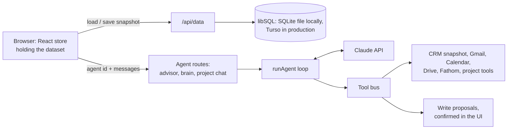

# Pallisade OS

Pallisade OS is the internal operating system I built to run Pallisade Data, my one-person AI consultancy. It keeps leads, outreach, calls, follow-ups, pricing, projects and daily activity in one place, and puts Claude-based agents on top of that data, so the questions I have every morning ("who is waiting on a reply from me?", "which deals are going cold?", "what should this build cost?") get answered from the records instead of from memory.

It's a single-user tool, not a product. The interesting part is how the AI is kept honest: agents only receive the tools whose integrations are actually connected, code sets the price range and the model only places a number inside it, a failed model call is never shown as an answer, and client names are removed before any content prompt is built.

## What it does

- **Pipeline.** A leads CRM with filtering, call and interaction notes, a pain-point bank that surfaces recurring problems, prospect lists imported from CSV with a randomised daily dial list, and a Gmail inbox reader.
- **Follow-ups.** Scans sent mail and ranks the people who are owed a reply, using an LLM judge with a rule-based fallback (details below).
- **Pricing.** A quote calculator that derives a price band from comparable deals and running costs, then asks a model where inside the band to land.
- **Delivery.** Projects with milestones, a Gantt view and tasks, plus commit activity from a linked local or GitHub repo, attributed to milestones.
- **Agents.** A Sales Advisor chat, a set of strategy agents (pipeline analyst, deal strategist, discovery coach, product brainstorm, strategist) and a per-project agent. All of them can read the CRM and, when connected, Gmail, Google Calendar, Google Drive and Fathom call recordings.
- **Content Studio.** A daily job that drafts LinkedIn posts from the week's logged work in my own measured writing style, and rejects drafts that read as machine-written or that would disclose a client.
- **Daily rhythm.** A dashboard, a daily scorecard with trend charts, an AI business review written from a brain-dump, a rule-based plan for tomorrow, a model-curated news feed (GitHub, RSS, Reddit), a flashcard-style meeting-prep trainer, an agenda from Google Calendar, a notebook, and voice dictation through Whisper.

## How it works



The browser holds the whole dataset in a React context (`src/lib/store.tsx`) and persists it through a `StorageAdapter` interface (`src/lib/db/adapter.ts`). The default adapter sends snapshots to `/api/data`, which writes them with `@libsql/client`: a local SQLite file at `data/pallisade.db` in development, or Turso when `TURSO_DATABASE_URL` is set.

Everything that calls a model runs server-side in Next.js route handlers. API keys never reach the browser, and the browser only names an agent and sends messages. The context a tool runs against, such as the CRM snapshot or the current project, is assembled on the server.

## Engineering notes

### One agent loop, with agents defined in Markdown

Each agent is a Markdown file in `src/agents/`. Its frontmatter declares which surface it appears on and which capability groups it may use (`crm`, `email`, `calendar`, `drive`, `projects`, `delivery`, `web`, `writes`, `fathom`), and its body is the system prompt. `src/lib/agents/registry.ts` loads and validates the files. `runtime.ts` is the single tool-use loop shared by every surface, capped at eight iterations and able to resume server-side web search. `capabilities.ts` is the tool bus: it maps groups to tools and routes each call to the resolver that owns it.

The decisions worth noting:

- A group only grants tools when its integration is connected. Agents that were handed tools answering every call with "not connected" passed that on as a fact about my setup. Gating the grant removed that failure mode.
- Tool errors go back to the model as JSON instead of being thrown. The agent can then say the calendar is unreachable, and the turn carries on.
- Every write (create a task, update a lead, book a calendar event) is queued as a proposal and only applied when I click Confirm.
- The reason a turn stopped (`end`, `max_iterations` or `max_tokens`) is passed to the UI, so a truncated answer is labelled as partial.
- Prompt bodies can be edited in Settings and are stored in the database, but frontmatter stays in the files. Editing a persona can't widen what it is allowed to touch.

### Follow-up audit: an LLM judge with a rule-based fallback

`/follow-ups` answers "who is waiting on me?". `src/lib/gmail/sentAudit.ts` pages through up to 400 recent sent threads across the connected inboxes. It keeps eight fetches in flight to stay under Gmail's quota and retries once on a rate limit. It strips quoted text, then buckets each thread by who wrote last: `awaiting_you`, `no_reply` or `stalled`.

Each thread is then judged by Jev, TypeSafe's evaluation model (`src/lib/gmail/sentJudge.ts`), to decide whether it is real outreach and whether a nudge is owed. Jev receives a de-quoted, newest-first view of the thread capped at 6,000 characters, plus three typed questions:

- Is this genuine outreach? Answered as a probability, with the threshold at 0.5.
- Is a follow-up owed now? Also a probability with a 0.5 threshold.
- How urgent is it? A four-level score from "dead" to "hot".

Without a TypeSafe key, the whole audit runs on a keyword and sign-off heuristic instead. With a key, a failed Jev call only drops that one thread back to the heuristic, and the result reports how many threads fell back. A compare mode runs both methods and counts where they agree. The last ten runs are stored, so the two can be compared over more than a single run.

Auth failures are never swallowed. A revoked Gmail token surfaces as a prompt to reconnect the inbox, not as an empty list that would read as "nobody needs a reply".

### Pricing: code sets the range, the model picks the spot

`src/lib/pricing/` turns a scoped build into a price band:

- **Similarity.** Similarity between two builds is a weighted mix of feature distances: closeness of counts, Jaccard overlap of integrations, ordinal distance for AI depth and support load, and a log-scaled user count.
- **Anchor.** Comparables below 0.5 similarity are dropped. The rest are weighted by similarity times provenance: my own won deals 1.0, published market prices 0.7, references I wrote myself 0.6. The anchor is a weighted percentile, and with fewer than three comparables there is no anchor at all.
- **Bounds.** The monthly floor comes from running costs, including model usage priced per token, plus a target margin. Ceilings are scaled by an ability-to-pay band researched with web search, where every claim must carry a source URL. The setup ceiling is also capped at the lowest price a similar deal was lost on. A deal lost on price only ever informs the ceiling and never enters the anchor.

Only after that is a model asked to place target and stretch prices inside the bounds. Anything it proposes outside them is clamped, and each adjustment is explained in a sentence. The model never sees the individual comparable prices, so it can't work out a different range for itself.

### Content Studio: statistics against AI-sounding prose

The daily engine (`src/lib/content/daily/`, run on a Vercel cron) collects the week's logged calls, notes and project work into a ranked list of source material, picks briefs and writes drafts. Every draft then goes through a gate written in plain code before I see it.

The gate compares the draft's writing statistics with a profile built from my own writing samples. These are sentence-length burstiness (standard deviation over mean, with an absolute floor of 0.3), average sentence and paragraph length, the share of short sentences, and the contraction rate. It also checks for known AI phrasings, strings of one-line paragraphs, and specific details that can't be traced back to a source record. A draft that fails goes back for revision with a named list of defects, for up to two rounds. A vague instruction like "make it better" is never sent to the model.

Client names are kept out by construction, not by asking the model nicely. Every company and contact in the CRM is redacted from the material before any prompt is built (`redact.ts`), so the model can't publish a name it never saw. A separate check (`disclosure.ts`) blocks posts that reveal the business's own numbers or a struggle that is still unresolved.

### Persistence that a stale tab can't wipe

Data is stored as JSON documents, one table per collection (`id`, `json`, `updated_at`). That keeps the schema simple and lets the same code run against a local file or Turso. Because the browser saves whole snapshots, two guards matter:

- The server refuses an empty snapshot over a populated database.
- Data the server writes itself (follow-up runs, Content Studio posts, agent prompt overrides) lives in tables outside the snapshot, so a tab opened before a cron run can't erase that data on its next save.

### Failures look like failures

An early version had a mock AI layer that returned plausible output when no key was set. It was deleted, and `src/lib/agents/noMock.test.ts` makes sure it stays deleted. Without a key, AI features now say "No model configured" instead of rendering an invented summary. Call summaries and the business review use JSON-schema-constrained output, and an empty result is rejected. The dashboard's plan for tomorrow is deliberately rule-based ranking, not a model call.

### Tests checked against mutations

Most logic is written as pure functions with the I/O at the edges, so the Vitest suite (more than 1,100 tests) runs without network access or a database server. `scripts/mutate.sh` applies a find-and-replace mutation to a source file, runs that file's paired test, and reports whether any test failed. The status records in `docs/superpowers/plans/` note which mutations each feature's tests were checked against.

### Specs before code

`docs/superpowers/` holds a design spec and an implementation plan for each feature, plus a status record for the larger ones. They are the best place to see why something works the way it does.

## Stack

- Next.js 15 (App Router), React 19, TypeScript in strict mode
- Tailwind CSS v4 design tokens (`src/app/globals.css`), Geist fonts, lucide-react icons, hand-written SVG charts with no charting library. The look is a dark, terminal-style interface with a single crimson accent.
- libSQL through `@libsql/client`: a SQLite file locally, Turso when hosted
- Anthropic SDK: Claude Sonnet models with tool use, server-side web search and structured output
- TypeSafe Jev for follow-up judging, OpenAI Whisper for dictation, the Fathom API for call recordings
- Google OAuth for Gmail, Calendar and Drive, and Auth.js with a single-email allowlist for login
- Vitest

## Running it locally

You need Node 22 or newer and npm.

To try it without any setup, run the development server:

```bash
npm install
npm run dev      # http://localhost:3000, with hot reload
```

In development, the login gate is skipped while `AUTH_GOOGLE_ID` is unset, so the app opens straight away. It starts empty, and everything you add is stored in `data/pallisade.db`, which is gitignored. To see it populated, use **Settings → Data → Load demo data**, which loads a dataset of fictional companies. **Clear all data** wipes it back to empty.

Configuration lives in `.env.local`, so copy `.env.example` to `.env.local` to start. Every integration is optional and stays dormant until its key is set. Add `ANTHROPIC_API_KEY` for the AI features; **Settings → AI** shows whether a model is connected.

**For day-to-day use on macOS, double-click `Pallisade OS.command`.** It installs dependencies on first run, builds the app (about 30 seconds the first time, and again whenever the code changes), starts the production server and opens the app in its own Chrome window, or your default browser if Chrome isn't installed. Close the small terminal window it opens to quit the app. Because this is a production build, the Google login is always enforced. Set `AUTH_SECRET`, `AUTH_GOOGLE_ID`, `AUTH_GOOGLE_SECRET` and `AUTH_ALLOWED_EMAIL` in `.env.local` first (see `.env.example`). Without them, every page redirects to a login that can't complete.

> Tip: drag `Pallisade OS.command` to your Dock, or make an alias on your Desktop. The first time, macOS may ask you to confirm opening it: right-click it and choose Open.

The other scripts:

```bash
npm run app      # same as the double-click launcher (production build + server)
npm run build    # production build
npm start        # serve an existing production build
```

For a hosted deployment on Vercel with Turso and Google login, see [`DEPLOY.md`](DEPLOY.md).

## Tests

```bash
npm test             # Vitest, single run
npm run test:watch   # Vitest in watch mode
npm run typecheck    # tsc --noEmit
```

CI (`.github/workflows/ci.yml`) runs the typecheck and the test suite on Node 22 for every push and pull request. There's no ESLint configuration yet, so `npm run lint` (which calls `next lint`) isn't part of CI.

## Status

The app works and is in active development. It's built around one person's workflow, and some of that is hard-coded. For example, the follow-up heuristic looks for "Pallisade" in the subject and "Emil" as the sign-off (`src/lib/gmail/sentScan.ts`), and the agent prompts describe my market. It isn't packaged for anyone else to run as-is, though `DEPLOY.md` documents the full hosted setup.

## Project layout

```
src/
  agents/                    # agent definitions: frontmatter + system prompt
  app/                       # one folder per page, plus api/ route handlers
  components/                # UI, grouped by feature
  lib/
    agents/                  # registry, runtime loop, tool bus
    advisor/ brain/ projects/
                             # tools for each chat surface
    gmail/ calendar/ drive/ fathom/ jev/
                             # integrations
    content/daily/           # Content Studio engine
    pricing/                 # quote engine
    db/                      # storage adapter and libSQL persistence
    store.tsx                # client state, CRUD, search, persistence
    types.ts                 # domain model
    seed.ts                  # fictional demo dataset
docs/superpowers/            # design specs, implementation plans, status records
scripts/                     # launcher, mutation-testing harness, Turso migration
```
